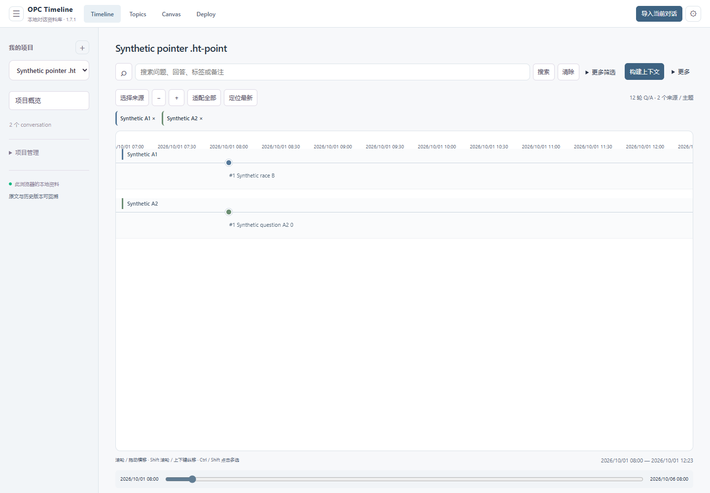

# OPC Timeline

面向 AI 对话的本地可视化知识工作空间：将 ChatGPT 对话整理为 Project、Q/A 时间线、知识卡片与可检索的上下文。

[安装指南](docs/installation.md) · [构建与测试](docs/testing.md) · [架构](docs/architecture.md) · [隐私说明](docs/privacy.md) · [发布记录](docs/releases/v1.7.1-beta.1.md)

当前版本：**1.7.1-beta.1**，Chrome 数字版本 `1.7.1`。这是开发者模式安装的 Beta，不是 Chrome Web Store 上架版本。

## 为什么做这个项目

长对话中的结论容易被后续消息淹没，多个对话之间的资料也难以一起回顾。OPC Timeline 保留问答与来源关系，让用户按项目组织、沿时间线阅读、搜索和标注，并为下一次讨论整理上下文。

## 已实现的功能

- **Project 与 Conversation**：独立项目、多对话管理、来源选择与切换。
- **Timeline 与 Reader**：横向时间线、分对话轨道、缩放和平移、点击 Q/A 节点阅读原文。
- **知识组织与检索**：搜索问题、回答、标签和备注；本地标签与主题建议。
- **Canvas 与 Deploy**：手动关系连接、保存画布位置、从所选记录组装可追溯的上下文包。
- **导入与导出**：明确操作后采集当前 ChatGPT 对话，预览后保存；结构化 JSON 导入；项目/资料库备份，Markdown、HTML、DOCX 导出和浏览器打印。
- **可选分析**：离线规则分析、BGE 本地向量分析；通过配对的本机 Node 代理进行实验性 OpenAI 分析。核心浏览与组织无需 API Key。

采集依赖 ChatGPT 页面及非公开数据格式。

## 实际界面

下图来自真实扩展页面和隔离浏览器中的合成测试数据，不包含私人聊天。来源见[截图说明](docs/screenshots/README.md)。



## 安装与开始使用

在 [GitHub Releases](https://github.com/Beyond39/ai-timeline/releases) 下载对应版本的插件 ZIP 与 `SHA256SUMS.txt`。如该版本尚无在线附件，请按下一节从源码构建。

1. 将插件 ZIP 解压到固定目录，确认第一层有 `manifest.json`。
2. 打开 `chrome://extensions`，开启「开发者模式」，选择「加载已解压的扩展程序」。
3. 选择刚解压的目录，在扩展详情的「扩展程序选项」打开完整 Workspace。
4. 创建 Project，导入支持的 JSON，或在已保存的 ChatGPT 对话页点击扩展图标，采集、预览并保存。
5. 用 Timeline 阅读问答，添加标签与备注，在 Canvas 连接卡片，使用 Deploy 组装上下文。

升级前分别导出资料库和知识分析备份；保留原扩展条目与加载路径，更新后重新加载。更换路径或浏览器配置可能改变扩展身份。完整步骤见[安装与升级](docs/installation.md)。

## 从源码构建

需要 Git、**Node.js 22+**；本轮使用 Node `24.22.1`。核心构建与 Node 测试只使用内置模块和仓库内 vendor，**无需 npm install 或 Python 服务**。

```powershell
git clone https://github.com/Beyond39/ai-timeline.git
cd ai-timeline/apps/navigator-extension
npm test
npm run build
npm run verify:package
```

若 PowerShell 阻止 `npm.ps1`，使用 `npm.cmd`。输出：

| 路径（相对插件目录） | 用途 |
| --- | --- |
| `dist/ai-conversation-visual-navigator/` | Chrome 可加载目录 |
| `dist/ai-conversation-visual-navigator-v1.7.1.zip` | 运行安装包，manifest 位于 ZIP 根目录 |
| `dist/SHA256SUMS.txt` | SHA-256 校验值 |

大型性能 fixture 和原开发机输出不参与构建。第三方 JavaScript、WASM 与 tokenizer 已随源码保留；BGE 模型权重需用户单独下载或导入。

## 技术架构与目录

原生 JavaScript ES modules、HTML/CSS 与 DOM 渲染；Chrome Manifest V3 模块 Service Worker 统一处理消息，IndexedDB 保存资料。Workspace 与 Side Panel 共享控制器，修订号检查防止并发旧写入覆盖数据。知识缓存与分析历史分别保存。

```text
apps/navigator-extension/  正式 Chrome 插件
  adapters/ importers/    采集、来源适配与导入
  domain/ storage/       业务规则、数据与备份
  analysis/ exports/     可选分析、文档导出
  ui/ icons/ vendor/     界面、静态资源与离线依赖
  scripts/ validation/   构建、测试及合成 fixture
docs/                    架构、隐私、安装、验证与发布记录
tools/opc-ai-proxy.mjs    可选本机 AI 代理
ai_memory/ tests/         保留的 Python/SQLite 早期原型与测试
contracts/ schemas/       原型契约与数据结构
```

Python 原型版本 `0.4.2` 是独立组件，不应与插件版本混用。网站 `apps/navigator-site` 是本地独立仓库，不是插件依赖，也不作为缺少 URL 的子模块发布。数据、输出、浏览器 Profile 和历史备份保留在本地并由 Git 忽略。

## 测试与验证

```powershell
# 在 apps/navigator-extension 中
npm test                 # 25 个 Node 功能套件及静态检查
npm run check            # MV3、模块引用、HTML/图标与资源检查
npm run build
npm run verify:package   # 版本、源码/安装目录/ZIP 字节一致性和校验值

# 仓库根目录：早期 Python 原型，不是插件运行依赖
python -m unittest -v
```

真实 MV3 浏览器测试使用可选 Playwright、独立配置与合成数据，覆盖多 Project 缩放、节点点击、切换、刷新、重启、并发编辑与 Side Panel 同步。命令、当前结果和独立克隆验证见[测试记录](docs/testing.md)与[本轮交付报告](docs/repository-finalization.md)。自动化通过不代表已验收私人旧配置或真实登录采集。

## 数据与隐私

导入资料主要存于当前浏览器的 IndexedDB；本应用不加密本地数据库或导出文件。卸载扩展、删除浏览器配置或清理存储可能造成资料丢失。普通项目备份不包含全部知识缓存与分析历史，请分别备份。

采集使用用户明确选择的 ChatGPT 页面及其已有登录态。核心整理在本地运行；可选 BGE 初始化会联系 Hugging Face；可选 AI 经 `127.0.0.1:8787` 代理将选中的 Q/A 正文发送到 OpenAI，需确认后执行。API Key 仅放在代理环境变量中。代码审查未发现云同步或遥测管线，具体边界见[隐私说明](docs/privacy.md)。

不要在 Issue 中上传对话导出、数据库、Cookie、API Key、浏览器 Profile 或未脱敏截图。历史数据库审计结论和扫描范围见[安全审计](docs/security-audit.md)。

## 已知限制与后续计划

- ChatGPT 非公开格式可能变化；真实登录采集、附件正文与流式回复需要独立验收。
- 多 Project 自动化采用合成数据，不能证明用户原有私人配置中的历史故障已修复。
- 实验性 AI 的真实付费调用与输出质量、Word/WPS 文档效果、所有旧版 Chrome 均未在本轮验证。
- 后续维护优先处理真实采集兼容性、备份恢复与原位升级验收、跨浏览器回归和更稳定的浏览器测试配置。

## License 与第三方依赖

项目沿用现有 [MIT License](LICENSE)，不改变既有授权。KaTeX、Transformers.js、ONNX Runtime 和 BGE 分别保留各自声明；详见[第三方清单](apps/navigator-extension/docs/THIRD_PARTY_NOTICES.md)及[素材来源](docs/license-review.md)。插件 ZIP 包含主许可和 vendor 许可。可选模型权重不在安装包内。

OPC Timeline is a local-first Chrome extension for organizing AI conversations into project-based Q/A timelines, a relationship canvas, and reusable context. See the linked architecture and installation guides for technical details.
