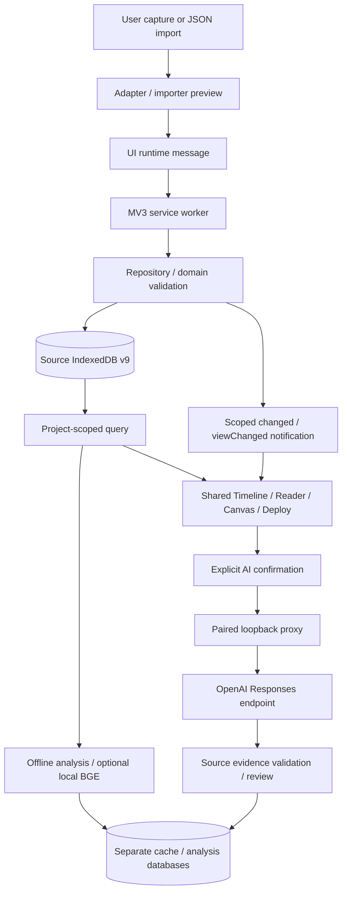

# Architecture

This describes the working tree audited on 2026-10-25, numeric extension version 1.7.1. Earlier product labels differ from Chrome version numbers. No React, TypeScript, Vite, cloud database or hosted SaaS is involved in the extension runtime.

## Entry points and modules

| Boundary | Actual implementation | Responsibility |
| --- | --- | --- |
| Manifest V3 | `apps/navigator-extension/manifest.json`, `background.js` | Action, selected-tab permission, Side Panel, Workspace and message dispatch |
| Shared UI | `sidepanel.html`, `workspace.html`, `ui/app.js`, `ui/dom.js` | Native DOM, selection state, dialogs, RPC, refresh and interaction coordination |
| Timeline | `ui/opc.js`, `ui/horizontal-timeline.js`, `domain/timeline-viewport.js`, `domain/timeline-tracks.js` | Project-scoped reads, atomic navigation commit, time geometry, source lanes, pan and window-local zoom |
| Organization | `domain/project-workspace.js`, `ui/project-workspace.js`, `ui/conversation-library.js`, `ui/global-search.js` | Workspace associations, conversation metadata and local search |
| Capture/import | `adapters/`, `importers/`, `ui/capture-source.js` | Explicit same-origin capture, supported JSON normalization, preview and diagnostics |
| Domain | `domain/` | Stable source identities, immutable text versions, Q/A, membership, relationships, suggestions, backups and context compilation |
| Persistence | `storage/repository.js`, `storage/database.js`, `storage/opc.js` | Command routing/queues, project-scoped queries, atomic IndexedDB revision comparison and writes |
| Knowledge | `analysis/`, `ui/knowledge.js`, `ui/conversation-knowledge.js` | Offline TF-IDF/topic/stage derivation; optional BGE worker; review and versioned conversation analysis |
| Optional external AI | `analysis/ai-client.js`, `analysis/ai-protocol.js`, `tools/opc-ai-proxy.mjs` | Page-memory pairing, consent and budget plan, loopback authentication, OpenAI request and evidence validation |
| Export | `exports/`, `ui/documents.js`, `ui/context-deploy.js`, `print.html` | Context packages, Markdown/HTML/DOCX and browser print |
| Validation/build | `validation/`, `scripts/` | Synthetic fixtures, Node suites, native MV3/bridge tests, static linkage checks, deterministic ZIP |

## Data flow

Capture's session credential and account-cookie access stay in the selected website's MAIN world. The returned graph uses a field whitelist. It may still contain private message text, author names, attachment/citation metadata and source URLs; sanitizing credentials is not anonymizing content.

## State and concurrency

The source database is `ai-conversation-visual-navigator`, schema version 9. Records carry Project/Conversation identities and source versions. Mutations are queued in the background; `commit()` reads and compares the database revision inside the same readwrite transaction before updating changed records. Object-level expected revisions protect annotations. Competing writes are rejected rather than silently overwriting.

Each page holds its own selection and viewport. `HorizontalTimeline.views` is keyed by Project; zoom/pan do not produce shared preference writes. Explicit source selections still persist with revision checks. Workspace associations reuse source records rather than making independent duplicate conversations.

`OPCTimeline.load()` captures target identity, request epoch and navigation epoch before asynchronous work. It prepares data first, waits for relevant pointer/dialog work, drains pending old-project writes, rechecks identity, then commits data, scope and rendered state together. `ui/app.js` retains the latest queued project choice and deferred refresh. Pointer tracking is reconciled on actual release evidence, blur or visibility changes; resize rendering observes the same interaction boundary. See [failure paths and source anchors](multi-project-regression.md).

## Storage boundaries

- Main IndexedDB: projects, raw messages/versions, Q/A, annotations, relationships, layouts, source choices and context/document records.
- `opc-knowledge-engine-v1`: derived embeddings, runs and reviews; no replacement of the main database.
- `opc-conversation-analyses-v1`: versioned analyses and manual revision history; separate knowledge export/import.
- Cache Storage `transformers-cache`: model data for optional embeddings.
- `chrome.storage.local`: UI restore selections/layout/drafts; `chrome.storage.session`: temporary capture binding. No `chrome.storage.sync` data pipeline was found.
- Proxy memory: pairing validation, running jobs, limited analysis response cache and session budget reservations. Closing it clears that process state; it is not an extension database.

The prior Python 0.4.2 prototype uses Python standard library/SQLite and has its own CLI/local web service. It is retained for history and separate tests; its data contracts and database are not the extension's persistence layer.
